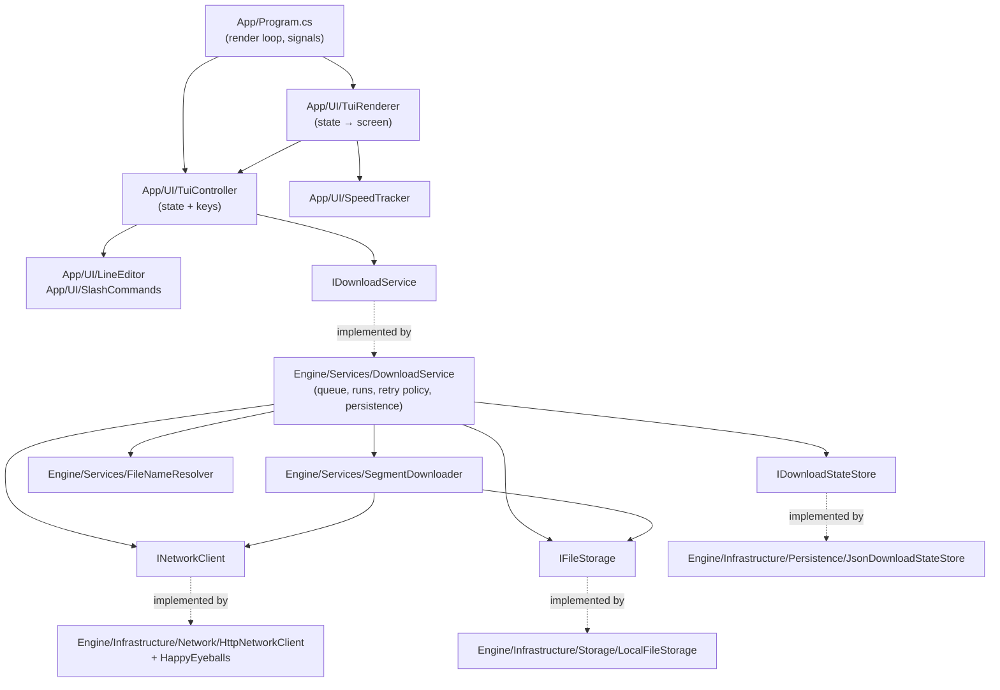
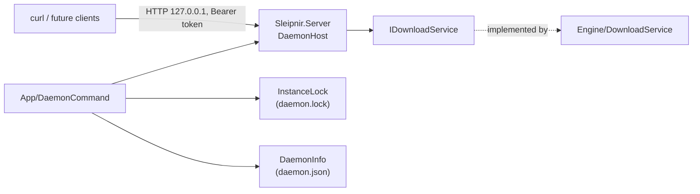
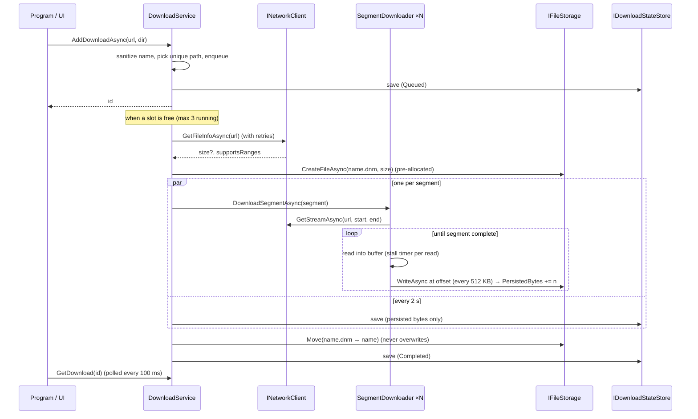
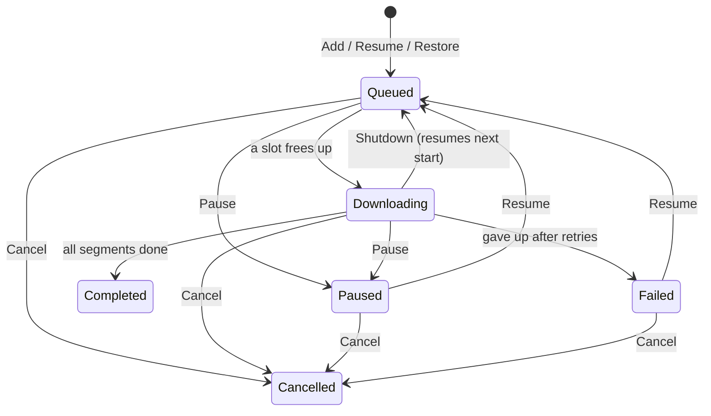

# Architecture

## Goals

- **Correctness first**: a file marked complete is byte-identical to the source, whatever
  happens in between (pauses, retries, crashes, restarts, misbehaving servers).
- **Use the bandwidth**: parallel ranged requests where the server allows it.
- **Survive real networks**: dropped and stalled connections, rate limiting, broken IPv6.
- **Testable core**: the download engine depends on interfaces, not on HTTP or the file system,
  so it can be tested with in-memory fakes.

## Layers



| Project / folder | Contents | Depends on |
|--------|----------|------------|
| `Sleipnir.Core/Models` | `DownloadTask`, `DownloadSegment`, `DownloadStatus`, `RemoteFileInfo`, `DownloadRecord` | nothing |
| `Sleipnir.Core/Interfaces` | `IDownloadService`, `INetworkClient`, `IFileStorage`, `IDownloadStateStore`, `RangeNotSupportedException`, `ServerBusyException` | Models |
| `Sleipnir.Engine/Services` | Download orchestration, segment downloading, file naming, options | Core |
| `Sleipnir.Engine/Infrastructure` | `HttpClient`, file system, and JSON implementations of the interfaces | Core |
| `Sleipnir.App/UI` | Interactive state and key handling (`TuiController`, `LineEditor`, `SlashCommands`), screen rendering (`TuiRenderer`), speed measurement | Core |
| `Sleipnir.App/Program.cs` | Composition root, the keyboard/render loop, signal handling | everything |

## The daemon

`dnm daemon` hosts the same engine behind a local API. `Sleipnir.Server` is a library (ASP.NET Core
minimal APIs on Kestrel) that wraps any `IDownloadService`:



- **Request pipeline:** problem+json error mapping → `Host` allowlist (`localhost`, `127.0.0.1`, `[::1]`)
  → bearer-token check (the right token always passes; wrong guesses are throttled; requests without
  credentials are refused without counting) → endpoints. No CORS headers are ever sent.
- **One engine per user:** `InstanceLock` is an exclusive open file handle in the runtime directory,
  taken by both `dnm daemon` and the interactive screen, so two processes never write the same state.
  The operating system releases it if the process dies.
- **Ports:** `127.0.0.1` and `[::1]` (when the OS has IPv6) share one port, starting at 7766 and moving
  up to 20 ports if busy. Clients must read the real port from `daemon.json`.
- **Shutdown:** `POST /api/v1/server/shutdown`, SIGTERM, SIGINT or SIGHUP stop the host, then call
  `ShutdownAsync` so progress is saved and downloads resume on the next start.

## Download lifecycle



### 1. Probing the server: `HttpNetworkClient.GetFileInfoAsync`

1. Send `HEAD`. If it succeeds with `Content-Length` and `Accept-Ranges: bytes`, we're done.
2. Otherwise (HEAD rejected, no size, or ranges not advertised), send `GET` with `Range: bytes=0-0`:
   - `206` with `Content-Range: bytes 0-0/TOTAL` means size = TOTAL and ranges are supported.
   - `200` means size = `Content-Length` (possibly unknown) and ranges are **not** supported.

The probe goes through the same retry policy as segments (see §4).

### 2. Segmenting: `DownloadService.CreateSegments`

`count = clamp(size / MinSegmentSize, 1, SegmentCount)` (defaults: 1 MB, 8). Segments are equal
except the last, which absorbs the remainder. Without range support there is exactly one segment.

**Unknown size:** a single *open-ended* segment (`IsOpenEnded`) that reads until the server closes
the stream, then sets its real `EndOffset`. Retries and resumes restart it from byte 0, truncating
the temp file first.

The segment list is created once and **assigned as a whole** (`IReadOnlyList`), never mutated, so the
UI thread can enumerate it while downloads run.

### 3. Downloading a segment: `SegmentDownloader`

Each segment requests `Range: bytes=(start + persisted)-end`, reads in 80 KB chunks into a memory
buffer, and writes the buffer at the right offset of the pre-allocated `.dnm` file every 512 KB.

Each segment keeps two counters:

| Counter | Meaning | Used by |
|---------|---------|---------|
| `BytesDownloaded` | bytes received, including those still in the memory buffer | the UI (live progress) |
| `PersistedBytes` | bytes confirmed written to disk | resume and the state store |

**Key invariants:**
- `PersistedBytes` only advances after a write completes, so the saved state never claims bytes
  that aren't on disk. This holds even if the process is killed.
- Whenever `DownloadSegmentAsync` exits, for whatever reason, the buffer has been flushed (with
  `CancellationToken.None`, so the flush itself can't be interrupted) and the two counters are equal.
  If that flush fails, they roll back to the last successful write.

Other failure modes:
- `GetStreamAsync` rejects a ranged request that comes back as `200` by throwing
  `RangeNotSupportedException`. Writing a full-file body at a segment's offset would corrupt the file.
- A stream that ends before the segment is complete raises `IOException`.
- **Stall detection:** before every read, a linked token's timer is reset to `StallTimeout` (30 s). A
  connection that stays open but sends nothing trips it, and the segment raises `TimeoutException`.

### 4. Retry policy: `DownloadService.NextRetryDelay`

The probe and every segment share one policy, with two separate budgets:

| Error | Decision |
|-------|----------|
| `OperationCanceledException` from our own token | not an error: pause/cancel/shutdown |
| `RangeNotSupportedException` | no retry; `RunAsync` switches to single-stream mode and restarts |
| `ServerBusyException` (HTTP 429/503) | wait `Retry-After` if sent, else `RetryDelay × 2ⁿ` with jitter, capped at `MaxBusyDelay` (60 s); up to `MaxBusyRetries` (10) |
| `HttpRequestException` with 4xx (except 408/425/429) | permanent: fail at once |
| anything else (network errors, timeouts, early close) | up to `MaxRetries` (3), waiting `RetryDelay × n` (1 s, 2 s, 3 s) |

A retry resumes from `PersistedBytes`. When a segment gives up, it cancels a **linked token**
shared by all segments of the download, so the other connections stop immediately and the download
becomes `Failed`.

`HttpNetworkClient` turns HttpClient's own timeouts (reported as `TaskCanceledException`) into
`TimeoutException`. This keeps them from being mistaken for a user's pause, and gives them a readable
message.

### 5. Connecting: Happy Eyeballs

`SocketsHttpHandler.ConnectCallback` uses `HappyEyeballs.ConnectSocketAsync` (a simplified RFC 8305):
1. Resolve the host, then interleave address families (v6, v4, v6, v4…), keeping the resolver's
   preferred family first.
2. Start the first attempt. Each further attempt starts when the previous one **fails**, or after a
   **250 ms head start** if it is still pending.
3. The first successful connection wins. The others are cancelled, and disposed if they still succeed.

Without this, .NET tries addresses one at a time. On networks where IPv6 is advertised but
black-holed (common), every connection then hangs until the 30 s connect timeout, without ever trying
IPv4. Browsers and curl avoid this the same way.

### 6. Finishing

Once every segment is `Completed`, `name.dnm` is renamed to `name`. If `name` appeared on disk in the
meantime, a fresh unique name is chosen. `File.Move(..., overwrite: false)` guarantees nothing
existing is replaced. For unknown-size downloads, `TotalBytes` is set to the bytes received.

## Concurrency model: queue and runs

```
_queue:  [ id, id, id ]  (FIFO, waiting)   ──PumpQueue──▶   _runs: { id → DownloadRun }  (≤ MaxConcurrentDownloads)
```

A *run* is one execution of a download, from start/resume until it completes, pauses, fails, is
cancelled, or is stopped by shutdown:

```csharp
sealed class DownloadRun { CancellationTokenSource Cts; Task Completion; StopReason Reason; }
```

- **Add / Resume** put the id at the back of `_queue` and call `PumpQueue`. That starts runs while
  fewer than `MaxConcurrentDownloads` (3) are active.
- **Pause**: a queued download is simply removed from the queue. A running one has its token
  cancelled and `run.Completion` awaited.
- **Cancel**: same as pause with `Reason = Cancel`, then the `.dnm` file is deleted.
- **Resume** waits for any previous run to finish first, so two runs never write the same file.
- When a run ends, it saves its final state, removes **only its own** entry from `_runs`
  (`TryRemove(KeyValuePair)`), and calls `PumpQueue` so the next queued download starts.
- The final status is decided by the run itself, from `Reason`: `Pause → Paused`,
  `Cancel → Cancelled`, `Shutdown → Queued` (so it resumes next session).

Queue and run-table changes happen under a single lock (`_gate`). Segment counters use `Interlocked`,
because download threads write them and the UI thread reads them.

## Persistence: surviving restarts

`IDownloadStateStore` holds one `DownloadRecord` per download. `JsonDownloadStateStore` keeps them at
`$XDG_DATA_HOME/dnm/downloads/<id>.json` (usually `~/.local/share/dnm/downloads/`).

| When | What is saved |
|------|---------------|
| Add, pause (queued), resume, cancel | the new status |
| A run starts | status `Downloading`, size, range support |
| Every `StateSaveInterval` (2 s) while running | segment progress (`PersistedBytes` only) |
| A run ends | the final status, saved **before** it is published to `Status`, so anyone who sees the new status can rely on the saved state |
| `ShutdownAsync` | every download |

- **Atomic writes:** each record is written to `<id>.json.tmp`, then renamed over the old file, so a
  crash mid-write leaves the previous version intact. Unreadable files are skipped at start-up
  rather than crashing it.
- **Restore** (`RestoreAsync`, on start-up): records become tasks again. `Downloading` and `Queued`
  are re-queued and start automatically. `Paused`, `Failed` and finished downloads keep their status.
  Only the 200 most recent finished downloads are kept.
- **If the `.dnm` file is gone**, the run notices, recreates it and starts that download over.
- **Shutdown** (`ShutdownAsync`, from Ctrl+C twice, `/quit`, SIGTERM, SIGHUP): stop accepting new runs, stop
  every run with `Reason = Shutdown` (each one flushes its buffers), then save everything.

**Crash safety:** because only `PersistedBytes` is saved, the state on disk never runs ahead of the
data in the `.dnm` file. After a hard crash you lose at most the last couple of seconds of progress,
never correctness. (One caveat: after an OS crash or power loss, data the OS hadn't yet flushed from
its page cache may be missing. Sleipnir doesn't `fsync` on every write.)

## Status state machine



## The UI

A full-screen, keyboard-first interface modelled on chat-style terminal apps: a list above, an input
box always at the bottom, context-sensitive hints underneath.

```
Program.cs loop (every 50 ms)
  ├─ Console.ReadKey × everything available ──▶ TuiController.HandleKeyAsync   (state changes, service calls)
  ├─ SpeedTracker.Update
  └─ Live.UpdateTarget(TuiRenderer.Render(controller, speeds, width, height))
```

- **`TuiController`** owns the UI state: the input (`LineEditor`), selection, expanded row, help
  flag, suggestion index, toasts, and the double-press confirmations for Del and Ctrl+C. Its clock is
  injectable for tests. Keys go to the input box **unless it is empty**, in which case ↑↓ / Space /
  Enter / Del / ? act on the selection. This avoids single-letter shortcuts that would fight with
  typing. Plain text is treated as URLs (whitespace-separated, so a multi-URL paste adds them all);
  `/`-prefixed text is a command (`SlashCommands`, with unambiguous-prefix matching).
- **`TuiRenderer`** is pure: state in, `IRenderable` out. Every line is fitted to the terminal width
  (`Format.Fit`, never the last column). The list scrolls to keep the selection visible, and the body
  is padded so the input box sits at the bottom. Percentages use integer maths, so they never round
  up or show floating-point artefacts. Any text that comes from a URL or server **must** go through
  `Markup.Escape`.
- **`Program.cs`** switches to the terminal's alternate screen (restored on exit) and sets
  `Console.TreatControlCAsInput` so Ctrl+C reaches the controller as a key. `SIGTERM` (`kill`,
  `podman stop`), `SIGHUP` (terminal closed), and `SIGINT` as a fallback are registered with
  `PosixSignalRegistration`. All exit paths end in `ShutdownAsync`.

`SpeedTracker` keeps `(time, bytes)` samples for each running download over a 5 s sliding window.
Speed = bytes gained ÷ time elapsed across the window. ETA = remaining ÷ speed, and is unknown
without a size or while nothing arrives. If progress goes backwards (a single-stream restart), the
window is reset.

## Configuration

`DownloadOptions` (passed to the `DownloadService` constructor):

| Option | Default | Purpose |
|--------|---------|---------|
| `SegmentCount` | 8 | Max parallel connections per download |
| `MinSegmentSize` | 1 MB | Smaller files get fewer segments |
| `MaxConcurrentDownloads` | 3 | Downloads transferring at once; the rest are queued |
| `MaxRetries` | 3 | Retries for ordinary errors, per segment and for the probe |
| `RetryDelay` | 1 s | Base backoff; attempt *n* waits *n* × this |
| `MaxBusyRetries` | 10 | Retries for HTTP 429/503 (separate budget) |
| `MaxBusyDelay` | 60 s | Cap on a single "server busy" wait |
| `StallTimeout` | 30 s | No data for this long counts as a failed connection |
| `FlushThreshold` | 512 KB | Per-segment memory buffer before writing to disk |
| `StateSaveInterval` | 2 s | How often running downloads save their progress |

`HttpNetworkClient(headersTimeout)` defaults to 60 s, and bounds only the wait for response headers.

## Known limitations and next steps

See the [roadmap](https://github.com/Parth2500/Sleipnir/issues/1) and
[FEATURE_COMPARISON.md](FEATURE_COMPARISON.md).

| Limitation | Direction |
|------------|-----------|
| Options are hard-coded in `Program.cs` | Settings file (`~/.config/dnm/settings.json`), Phase 2 |
| No bandwidth limit | Token-bucket limiter around segment reads, Phase 2 |
| A download whose size is unknown can't resume mid-file | Inherent without ranges; nothing to do |
| One output folder (`~/Downloads`) | Part of the settings file / CLI mode |
