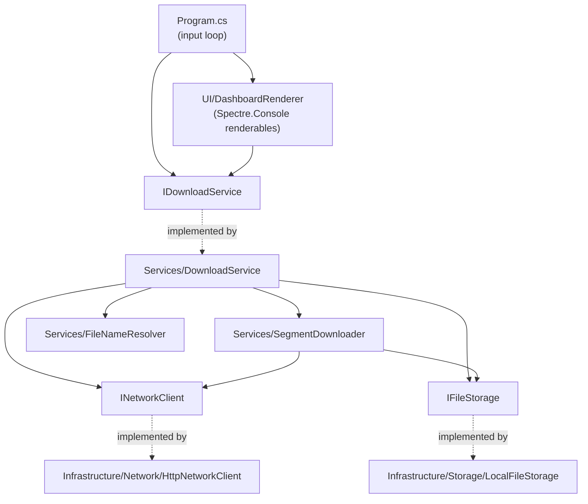
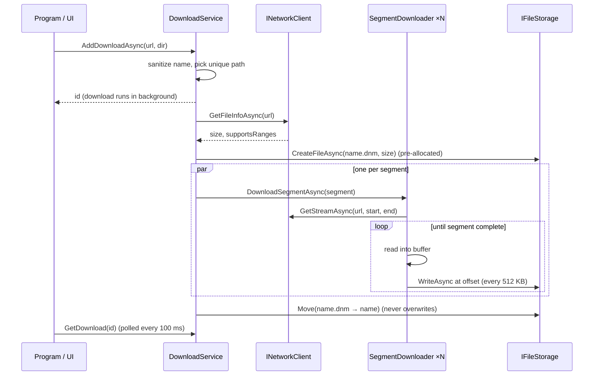
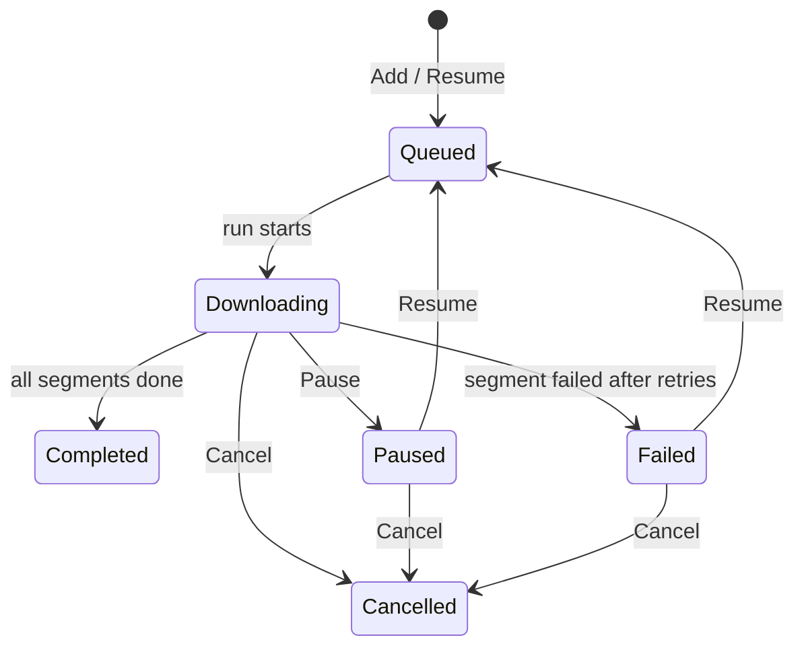

# Architecture

## Goals

- **Correctness first**: a file marked complete is byte-identical to the source, whatever
  happens in between (pauses, retries, misbehaving servers).
- **Use the bandwidth**: parallel ranged requests where the server allows it.
- **Testable core**: the download engine depends on interfaces, not on HTTP or the file system,
  so it can be tested with in-memory fakes.

## Layers



| Folder | Contents | Depends on |
|--------|----------|------------|
| `Core/Models` | `DownloadTask`, `DownloadSegment`, `DownloadStatus`, `RemoteFileInfo` | nothing |
| `Core/Interfaces` | `IDownloadService`, `INetworkClient`, `IFileStorage`, `RangeNotSupportedException` | Models |
| `Services` | Download orchestration, segment downloading, file naming, options | Core |
| `Infrastructure` | `HttpClient` and file system implementations of the interfaces | Core |
| `UI` | Pure functions that turn download state into Spectre.Console renderables | Core |
| `Program.cs` | Composition root and the keyboard/render loop | everything |

## Download lifecycle



### 1. Probing the server — `HttpNetworkClient.GetFileInfoAsync`

1. Send `HEAD`. If it succeeds with `Content-Length` and `Accept-Ranges: bytes`, done.
2. Otherwise (HEAD rejected, no size, or ranges not advertised) send `GET` with `Range: bytes=0-0`:
   - `206` with `Content-Range: bytes 0-0/TOTAL` → size = TOTAL, ranges supported.
   - `200` → size = `Content-Length`, ranges **not** supported.

### 2. Segmenting — `DownloadService.CreateSegments`

`count = clamp(size / MinSegmentSize, 1, SegmentCount)` (defaults: 1 MB, 8). Segments are equal
except the last, which absorbs the remainder. Without range support there is exactly one segment.

The segment list is created once and **assigned as a whole** (`IReadOnlyList`), never mutated, so the
UI thread can enumerate it while downloads run.

### 3. Downloading a segment — `SegmentDownloader`

Each segment requests `Range: bytes=(start + downloaded)-end`, reads in 80 KB chunks into a memory
buffer, and writes the buffer at the right offset of the pre-allocated `.dnm` file every 512 KB.

**Key invariant:** whenever `DownloadSegmentAsync` exits, for whatever reason,
`segment.BytesDownloaded` equals the bytes *actually on disk*. On pause or error the buffer is
flushed first (with `CancellationToken.None`, so the flush itself can't be interrupted). If that
flush fails, the counter is rolled back to the last successful write. A resume therefore never
skips data.

`HttpNetworkClient.GetStreamAsync` rejects a ranged request that comes back as `200` by throwing
`RangeNotSupportedException`. Writing a full-file body at a segment's offset would silently corrupt
the download.

A stream that ends before the segment is complete raises `IOException`, which counts as a failure
and is retried.

### 4. Retries and failures — `DownloadSegmentWithRetryAsync`

- Any error except cancellation is retried up to `MaxRetries` (3) times, waiting
  `RetryDelay × attempt` (1 s, 2 s, 3 s). A retry resumes from the bytes already on disk.
- After the last retry the segment cancels a **linked token** shared by all segments of the
  download, so the other connections stop immediately, and the download becomes `Failed`.
- `RangeNotSupportedException` is not retried. `RunAsync` catches it, switches the download to
  single-stream mode, and starts again.

### 5. Finishing

Once every segment is `Completed`, `name.dnm` is renamed to `name`. If `name` appeared on disk in the
meantime, a fresh unique name is chosen. `File.Move(..., overwrite: false)` guarantees nothing
existing is replaced.

## Concurrency model: runs

A *run* is one execution of a download, from start/resume until it completes, pauses, fails, or
is cancelled. `DownloadService` keeps at most one `DownloadRun` per download:

```csharp
sealed class DownloadRun { CancellationTokenSource Cts; Task Completion; bool CancelRequested; }
```

- **Pause**: cancel the run's token and `await run.Completion`. The run itself decides the final
  status (`Paused`) once the segments have stopped and flushed.
- **Resume**: wait for any previous run to finish, then start a new run. Two runs never write the
  same file.
- **Cancel**: set `CancelRequested`, cancel the token, await completion, then delete the `.dnm` file.
- A run removes **only its own** entry from the run table when it ends
  (`TryRemove(KeyValuePair)`). A late-finishing old run can't unregister a newer one.

State transitions that read and write the run table happen under a single lock (`_gate`). Segment
progress counters use `Interlocked`, because they are written by download threads and read by the
UI thread.

## Status state machine



## The UI

`Program.cs` runs a Spectre.Console `Live` display, rebuilds the layout every 100 ms from
`IDownloadService` state, and polls `Console.KeyAvailable` for input. To prompt for a URL it leaves
the live display, calls `AnsiConsole.Ask`, then re-enters it.

`DashboardRenderer` is a set of pure functions (state in, renderable out), which keeps them unit
testable. Any text that comes from a URL or server (file names, error messages) **must** go through
`Markup.Escape`. Otherwise a name like `movie [1080p].mkv` is parsed as markup and throws.

## Configuration

`DownloadOptions` (passed to the `DownloadService` constructor):

| Option | Default | Purpose |
|--------|---------|---------|
| `SegmentCount` | 8 | Max parallel connections per download |
| `MinSegmentSize` | 1 MB | Smaller files get fewer segments |
| `MaxRetries` | 3 | Retries per segment before the download fails |
| `RetryDelay` | 1 s | Base backoff; attempt *n* waits *n* × this |
| `FlushThreshold` | 512 KB | Per-segment memory buffer before writing to disk |

## Known limitations and next steps

| Limitation | Direction |
|------------|-----------|
| State is in memory only; no resume after restart | Persist `DownloadTask` + segments as JSON next to the `.dnm` file; reload on start-up |
| Every added download starts immediately | Scheduler with a max-active limit and a `Queued` backlog |
| Unknown-size (chunked) responses are rejected | Single-segment streaming mode with an open-ended length |
| A stalled connection that sends nothing is never timed out | Per-read idle timeout that turns into a retry |
| No speed / ETA display | Sample `BytesDownloaded` over a sliding window in the UI |
